<div align="center">

<!-- ======================================================== -->
<!-- 🌌 RETRO ARCADE / CYBER-DECK 2026 HEADER -->
<!-- ======================================================== -->


<br>

<!-- 🥀 ANIMATED CYBERPUNK CONSOLE SCREEN (MELANCHOLIC RETRO TYPING) -->
<a href="https://nottbell.vercel.app">
  
</a>

<br><br>

<!-- 🕹️ CONTROLLER HUD & STATUS METRICS -->
<p align="center">
  <a href="https://nottbell.vercel.app">
    
  </a>
  <a href="https://github.com/notbell1">
    
  </a>
  <a href="#-stage-3--cartridge-select-room-11-karya-publik-unggulan">
    
  </a>
  <a href="#-stage-6--multiplayer-lobby--player-stats">
    
  </a>
</p>

<!-- 🎮 RETRO D-PAD NAVIGATION -->
<p align="center">
  <code>╔═══════════════════════════════════════════════════════════════════════════════════╗</code><br>
  <code>║  🕹️ [D-PAD]: SELECT STAGE  ║  🅰️ [A]: EXECUTE QUEST  ║  🅱️ [B]: BACK TO TITLE   ║</code><br>
  <code>╚═══════════════════════════════════════════════════════════════════════════════════╝</code><br>
  <a href="#-stage-1--player-hud--catatan-kelam-status-diri"><code>[ 🥀 STAGE 1: STATUS DIRI ]</code></a> &bull;
  <a href="#-stage-2--playable-mini-game--rpg-percakapan-rasa"><code>[ ⚔️ STAGE 2: JEJAK RASA ]</code></a> &bull;
  <a href="#-stage-3--cartridge-select-room-11-karya-publik-unggulan"><code>[ 💾 STAGE 3: 11 CARTRIDGES ]</code></a> &bull;
  <a href="#-stage-4--rpg-skill-tree--combat-arsenal"><code>[ ⚡ STAGE 4: SKILL TREE ]</code></a> &bull;
  <a href="#-stage-5--sound-test-room--playlist-galau-tengah-malam"><code>[ 📻 STAGE 5: PLAYLIST MALAM ]</code></a> &bull;
  <a href="#-stage-6--multiplayer-lobby--player-stats"><code>[ 📡 STAGE 6: STATS & LOBBY ]</code></a>
</p>

<p align="center">
  
</p>

</div>

---

## 🥀 STAGE 1 : PLAYER HUD & CATATAN KELAM (STATUS DIRI)

<div align="center">

> *"Di dunia open-world yang luas ini, setiap baris kode yang kutulis larut malam adalah caraku bertahan hidup ketika seseorang yang paling kuperjuangkan memilih menghilang dari radar."*

<br>

| Karakteristik HUD | Indikator Gauge | Status & Efek Pasif Dalam Game |
| :--- | :--- | :--- |
| **Player Handle** | `Abbel (Notbell1)` | Full-Stack Architect & Cyber Security Artisan |
| **Tingkat Karakter** | `LEVEL 99` | **Kompilasi Larut Malam** *(Jam 03:00 AM Super Focus)* |
| **Kondisi Hati (HP)** | `[░░░░░░░░░░] 0 / 100` | 💔 **Patah Hati Akut** *(Fatal Exception: Memori Gagal Di-Free)* |
| **Kapasitas Rindu (MP)** | `[██████████] 999 / 999` | ☕ **Meluap Tanpa Henti** *(Overclocked oleh Kafein Pahit)* |
| **Kecepatan Koding** | `[██████████] 150 WPM` | ⚡ **Hyper-Productive** *(Mengalihkan overthinking menjadi karya)* |
| **Perisai Pertahanan** | `[████████░░] 85 / 100` | 🛡️ **Two-Tier Rate Limiting** *(Kebal dari serangan luar)* |
| **Tingkat Kewarasan** | `[████░░░░░░] 42 / 100` | 🌧️ **Lo-Fi Resonance** *(Tenggelam dalam sunyi, bangkit dalam kode)* |

</div>

```javascript
/* ══════════════════════════════════════════════════════════════════
 * CARTRIDGE MEMORY BUFFER: /dev/hati/pointer_rusak.js
 * ══════════════════════════════════════════════════════════════════ */
const PlayerOne = {
  identitas: "Abbel (Notbell1)",
  profesi: "Full-Stack Engineer & Cyber Security Artisan",
  kondisi: "Merancang sistem dengan presisi, menata hati yang terlanjur sunyi.",

  catatanTengahMalam: {
    asupanKopi: "Robusta pahit tanpa gula (tak terhitung per malam)",
    jamFavorit: "03:14 AM (saat dunia tertidur dan rindu mulai berbisik)",
    suaraLatar: "Rintik hujan di jendela & alunan piringan hitam Lo-Fi",
    statusHati: "SIGHEARTBREAK: Akses alamat rasa (Ternyata sudah NULL)."
  },

  prinsip: "Ketika manusia memilih pergi, kompilasi kode selalu setia dieksekusi."
};
```

<div align="center">

**“AKU MERANCANG ARSITEKTUR SISTEM AGAR TIDAK PERNAH CRASH,  
SEPERTI HATIKU YANG TERLANJUR CRASH KARENA KEPERGIANMU.”**

</div>

---

## ⚔️ STAGE 2 : PLAYABLE MINI-GAME & RPG PERCAKAPAN RASA

<div align="center">
<sub>🎮 <b>PILIH OPSI DI BAWAH INI UNTUK MEMAINKAN PETUALANGAN INTERAKTIF & DIALOG RASA:</b></sub>
</div>

<br>

<details open>
<summary><b>🕹️ [PLAYABLE 1] "BOSS BATTLE: Mengatasi Overthinking Jam 03:00 Pagi"</b></summary>
<br>

```text
╔══════════════════════════════════════════════════════════════════════════════╗
║  🚨 ALERT: Larut Malam Terdeteksi!                                           ║
║  Boss: "The Shadow of Unspoken Feelings & Memory Leaks" (HP: 9,999/9,999)    ║
║  Kondisi: Suasana hening jam 3 pagi memicu kerinduan mendadak!               ║
╚══════════════════════════════════════════════════════════════════════════════╝
```

**PILIH STRATEGI PERLAWANANMU:**

* [⚔️ **AKSI 1: Salurkan Energi Menjadi Kode Baru (PuskeswanApp v2.0.0)**](https://github.com/notbell1/puskeswanapp)
  > *Hasil:* **CRITICAL COMBO!** Mengoptimasi query hingga **-96%** dan menyelesaikan 60 automated tests! Rasa overthinking lenyap digantikan kepuasan karya nyata!
* [🛡️ **AKSI 2: Aktifkan Perisai Privasi (Nttbell Assistant)**](https://github.com/notbell1/nttbell-assistant)
  > *Hasil:* **VISUAL BLUR ACTIVE!** Melindungi layar dari prying eyes dan menyembunyikan memori lama di balik lapisan hover-to-reveal.
* [☕ **AKSI 3: Minum Secangkir Kopi Hangat & Dengarkan Lo-Fi**](#-stage-5--sound-test-room--playlist-galau-tengah-malam)
  > *Hasil:* +200 Ketenangan Jiwa! Mengikhlaskan yang telah lalu dan fokus menatap masa depan. **VICTORY! 🏆**

</details>

<details>
<summary><b>💬 [PLAYABLE 2] "DIALOGUE TREE: Percakapan Sunyi di Balik Layar Monitor"</b></summary>
<br>

> **Pengunjung:** *"Kenapa masih betah ngoding sampai selarut ini sendirian?"*  
> 
> **Abbel:**  
> *"Karena di jam 3 pagi, dunia berhenti menuntut banyak hal. Tidak ada percakapan yang harus dipaksakan, tidak ada harapan semu. Yang tersisa hanya layar monitor bertema gelap, secangkir kopi dingin, dan logika koding yang selalu jujur padaku."*  
> 
> 🎁 **Item Didapatkan:** `[+1 Kopi Tubruk Hangat]` &bull; `[+50 EXP Ketenangan Jiwa]`

</details>

<details>
<summary><b>🔓 [PLAYABLE 3] "KONAMI CHEAT CODE: Terminal Kode Rahasia"</b></summary>
<br>

```text
INPUT SEQUENCE: [ ↑ ] [ ↑ ] [ ↓ ] [ ↓ ] [ ← ] [ → ] [ ← ] [ → ] [ 🅱️ ] [ 🅰️ ] [ START ]
```

```sql
-- KODE CHEAT DITERIMA! MENGAKTIFKAN MODE KETAHANAN HATI:
UPDATE jiwa
SET 
    rasa_sakit = 0,
    fokus_berkarya = 100,
    dedikasi_arsitektur = 999999
WHERE nama_target = 'Abbel';

-- Status: 1 baris terpengaruh. Log kenangan tidak dihapus, melainkan dialihkan menjadi 11 karya publik!
```

</details>

<details>
<summary><b>📁 [PLAYABLE 4] "INVENTORY VAULT: Brankas Draf yang Tak Pernah Terkirim"</b></summary>
<br>

```text
[BRANKAS TERKUNCI // DIREKTORI: /arsip/rahasia/draf_pesan_terpendam.txt]
--------------------------------------------------------------------------------
"Terima kasih sudah pernah singgah walau hanya sekejap.
 Seluruh repositori publik ini kubangun bukan sekadar mencari panggung,
 melainkan sebagai monumen sunyi bahwa aku pernah berjuang tanpa lelah
 untuk menjadi seseorang yang pantas kamu banggakan.
 Semoga bahagiamu di sana selalu berjalan lancar dan penuh senyuman."
--------------------------------------------------------------------------------
[STATUS: DRAF PERMANEN TERSIMPAN • TIDAK PERNAH DIKIRIM]
```

</details>

---

## 💾 STAGE 3 : CARTRIDGE SELECT ROOM (11 KARYA PUBLIK UNGGULAN)

<div align="center">
<sub>🎮 <b>SELURUH 11 REPOSITORI PUBLIK TERDAFTAR RESMI DENGAN GIT TAG & TAMPILAN INTERAKTIF:</b></sub>
</div>

<br>

### 👑 REALM 1: SISTEM KEDINASAN & PENGABDIAN PUBLIK (EPIC TIER)

| Cartridge / Repositori Publik | Deskripsi Teknis & Peran Sistem | Mesin Teknologi | Status Rilis |
| :--- | :--- | :---: | :---: |
| 🐾 **[PuskeswanApp v2.0.0](https://github.com/notbell1/puskeswanapp)**<br><sub>[Release v2.0.0](https://github.com/notbell1/puskeswanapp/releases/tag/v2.0.0)</sub> | **Sistem Rekam Medis Veteriner & Surveilans Rabies Terpadu**<br>Digitalisasi poliklinik hewan UPTD Puskeswan Kota Pariaman: triage antrean realtime, surveilans gigitan rabies (GHPR), portal mandiri NIK anti-bot, dan optimasi kueri -96% (Debugbar). | `Laravel 13`<br>`React 19`<br>`Inertia v3`<br>`Tailwind v4`<br>`Pest PHP` | <br>⭐⭐⭐⭐⭐ |
| 🏛️ **[Balai Gadang Web GIS](https://github.com/notbell1/balai-gadang)**<br><sub>[Live Demo](https://balai-gadang.vercel.app/) &bull; [Release v1.0.0](https://github.com/notbell1/balai-gadang/releases/tag/v1.0.0)</sub> | **Web GIS Pemetaan Potensi Wilayah Balai Gadang 2026**<br>Pemetaan geospasial interaktif 80+ fasilitas umum, 25+ potensi UMKM & agrowisata, batas administratif RW, dan demografi Kelurahan Balai Gadang secara presisi. | `React 19`<br>`TypeScript`<br>`Leaflet JS`<br>`Tailwind v4`<br>`GeoJSON` | <br>⭐⭐⭐⭐☆ |
| 🎓 **[KKN UISB Balai Gadang](https://github.com/notbell1/kkn-uisb-balaigadang)**<br><sub>[Live Demo](https://kkn-uisb-balaigadang.vercel.app/) &bull; [Release v1.0.0](https://github.com/notbell1/kkn-uisb-balaigadang/releases/tag/v1.0.0)</sub> | **Portal Resmi Dokumentasi Pengabdian KKN Mahasiswa 2026**<br>Dokumentasi program kerja multidisiplin, linimasa kegiatan pengabdian masyarakat, profil 21 mahasiswa lintas 5 prodi, dan galeri interaktif. | `React`<br>`TypeScript`<br>`Tailwind CSS`<br>`Vite`<br>`Vercel` | <br>⭐⭐⭐⭐☆ |

<br>

<p align="center">
  <a href="https://github.com/notbell1/puskeswanapp"></a>
  <a href="https://balai-gadang.vercel.app/"></a>
</p>

---

### 🛡️ REALM 2: KEAMANAN SIBER & PERISAI PRIVASI (TACTICAL TIER)

| Cartridge / Repositori Publik | Deskripsi Teknis & Peran Sistem | Mesin Teknologi | Status Rilis |
| :--- | :--- | :---: | :---: |
| 🔍 **[Xeoo Auditor](https://github.com/notbell1/xeoo-auditor)**<br><sub>[Live Site](https://xeooauditor.xo.je/) &bull; [Release v1.0.0](https://github.com/notbell1/xeoo-auditor/releases/tag/v1.0.0)</sub> | **Privacy-First Website Auditing Engine & Security Toolkit**<br>Inspeksi teknis situs web dalam sekali klik: DNS records, sertifikat SSL/TLS, kepatuhan header keamanan HTTP (CSP, HSTS, X-Frame), dan tumpukan server secara stateless. | `React 19`<br>`TypeScript`<br>`PHP 8.4`<br>`MySQL`<br>`Tailwind v4` | <br>⭐⭐⭐⭐⭐ |
| 🛠️ **[Xeoo Tools](https://github.com/notbell1/xeoo-tools)**<br><sub>[Live Site](https://xeootools.site.je/) &bull; [Release v1.0.0](https://github.com/notbell1/xeoo-tools/releases/tag/v1.0.0)</sub> | **Multi-Utility Online Developer Swiss Army Knife**<br>Koleksi perkakas harian pengembang: Base64 encoder/decoder, pemformat JSON, regex tester, hash generator (MD5/SHA), dan konverter warna tanpa server roundtrip. | `React 18`<br>`TypeScript`<br>`Tailwind v4`<br>`PHP`<br>`MySQL` | <br>⭐⭐⭐⭐☆ |
| 🛡️ **[Nttbell Assistant](https://github.com/notbell1/nttbell-assistant)**<br><sub>[Release v1.0.0](https://github.com/notbell1/nttbell-assistant/releases/tag/v1.0.0)</sub> | **WhatsApp Web Visual Privacy Shield & Anti-Shoulder Surfing**<br>Ekstensi Chrome Manifest V3 cerdas yang mengaburkan pesan, kontak, dan media WhatsApp Web dengan efek hover-to-reveal & 100% pemrosesan lokal tanpa telemetri. | `Chrome MV3`<br>`TypeScript`<br>`Vite`<br>`MutationObserver`<br>`CSS Filter` | <br>⭐⭐⭐⭐☆ |

<br>

<p align="center">
  <a href="https://xeooauditor.xo.je/"></a>
  <a href="https://xeootools.site.je/"></a>
</p>

---

### 🎨 REALM 3: EKSTENSI VISUAL STUDIO CODE (FORGE TIER)

| Cartridge / Repositori Publik | Deskripsi Teknis & Peran Sistem | Mesin Teknologi | Status Rilis |
| :--- | :--- | :---: | :---: |
| ⚡ **[Xeoo Error Lens](https://github.com/notbell1/xeoo-error-suite)**<br><sub>[Release v1.2.0](https://github.com/notbell1/xeoo-error-suite/releases/tag/v1.2.0)</sub> | **High-Contrast Inline Diagnostics & Restrained Pulse Animation**<br>Visualisasi error dan warning langsung di baris editor dengan animasi denyut halus, saran perbaikan deterministik lokal, dan kalibrasi kontras WCAG AA. | `VS Code API`<br>`TypeScript`<br>`Color Science`<br>`Zero Telemetry` | <br>⭐⭐⭐⭐☆ |
| 🎨 **[Xeoo Icon Theme](https://github.com/notbell1/xeoo-icon-suite)**<br><sub>[Release v0.1.0](https://github.com/notbell1/xeoo-icon-suite/releases/tag/v0.1.0)</sub> | **Cybernetic & Precision-Engineered VS Code File Icons**<br>72 ikon vektor kustom geometris yang dirancang tajam untuk keterbacaan explorer mikro 16×16 tanpa dependensi luar. | `SVG Vector`<br>`VS Code API`<br>`File Icon Spec` | <br>⭐⭐⭐☆☆ |
| ✨ **[Xeoo Theme Suite](https://github.com/notbell1/xeoo-theme-suite)**<br><sub>[Release v2.2.2](https://github.com/notbell1/xeoo-theme-suite/releases/tag/v2.2.2)</sub> | **15 Master Color Categories & 43 Variants Theme Studio**<br>Suite tema editor lengkap (Dark, Soft, Light) dengan elevasi UI berjenjang (Header, Editor, Sidebar, Footer) dan 1-Click Studio Switcher di side panel. | `VS Code API`<br>`TextMate JSON`<br>`Color Harmony`<br>`WCAG AA` | <br>⭐⭐⭐⭐☆ |
| 📊 **[Core Vitality](https://github.com/notbell1/core-vitality)**<br><sub>[Release v1.0.0](https://github.com/notbell1/core-vitality/releases/tag/v1.0.0)</sub> | **Developer Velocity & Activity Analytics Dashboard for VS Code**<br>Pemantau waktu koding real-time, pengukur kecepatan baris kode, dan widget statistik sesi harian/mingguan langsung di status bar editor. | `VS Code API`<br>`TypeScript`<br>`Offline Analytics`<br>`Dashboard UI` | <br>⭐⭐⭐⭐☆ |

<br>

<p align="center">
  <a href="https://github.com/notbell1/xeoo-theme-suite"></a>
  <a href="https://github.com/notbell1/core-vitality"></a>
</p>

---

### 🌌 REALM 4: EKSPERIMEN 3D & PORTOFOLIO PERSONAL (INDIE TIER)

| Cartridge / Repositori Publik | Deskripsi Teknis & Peran Sistem | Mesin Teknologi | Status Rilis |
| :--- | :--- | :---: | :---: |
| 🪐 **[3D Solar System Portfolio](https://github.com/notbell1/portfolio)**<br><sub>[Live Site](https://nottbell.vercel.app/) &bull; [Release v1.0.0](https://github.com/notbell1/portfolio/releases/tag/v1.0.0)</sub> | **Interactive 3D Solar System Developer Portfolio Showcase**<br>Simulasi tata surya 3D kosmik interaktif di mana orbit planet-planet dinamis merepresentasikan portofolio, keahlian teknis, dan karya unggulan. | `React 19`<br>`TypeScript`<br>`Three.js / Canvas`<br>`Tailwind CSS`<br>`Framer Motion` | <br>⭐⭐⭐⭐⭐ |

<br>

<p align="center">
  <a href="https://nottbell.vercel.app/"></a>
</p>

---

## ⚡ STAGE 4 : RPG SKILL TREE & COMBAT ARSENAL

```mermaid
flowchart TD
    Player(["🎮 PLAYER: ABBEL (NOTBELL1)<br/>Level 99 Midnight Architect"]):::player
    
    Player --> F_TREE["⚔️ FRONTEND SORCERY"]:::branch
    Player --> B_TREE["🛡️ BACKEND ENGINEERING"]:::branch
    Player --> S_TREE["🔒 SECURITY & SYSTEM OPS"]:::branch
    Player --> T_TREE["⚙️ TOOLING & EXTENSIONS"]:::branch

    F_TREE --> F1["React 19 & Next.js"]:::skill
    F_TREE --> F2["TypeScript & Modern JS"]:::skill
    F_TREE --> F3["Tailwind CSS v4 & LightningCSS"]:::skill
    F_TREE --> F4["Three.js, Canvas & Framer Motion"]:::skill

    B_TREE --> B1["Laravel 13 & PHP 8.4 (JIT)"]:::skill
    B_TREE --> B2["Inertia.js v3 (Server-Driven SPA)"]:::skill
    B_TREE --> B3["MySQL / PostgreSQL Optimization"]:::skill
    B_TREE --> B4["RESTful API Architecture"]:::skill

    S_TREE --> S1["Two-Tier Rate Limiting Architecture"]:::skill
    S_TREE --> S2["Web Vulnerability & SSL Inspection"]:::skill
    S_TREE --> S3["Zero-Trust File Binary Validation"]:::skill
    S_TREE --> S4["WCAG AA Ergonomic Accessibility"]:::skill

    T_TREE --> T1["VS Code Extension API Architecture"]:::skill
    T_TREE --> T2["Chrome Extension Manifest V3"]:::skill
    T_TREE --> T3["Pest PHP Automated Feature Testing"]:::skill
    T_TREE --> T4["Leaflet JS & GeoJSON Spatial Mapping"]:::skill

    classDef player fill:#fb7185,stroke:#f43f5e,stroke-width:2px,color:#000,font-weight:bold;
    classDef branch fill:#22050e,stroke:#f43f5e,stroke-width:2px,color:#fff,font-weight:bold;
    classDef skill fill:#0b0407,stroke:#334155,stroke-width:1px,color:#e2e8f0;
```



<div align="center">

### 🛠️ Combat Equipment Grid

<p align="center">
  
</p>

</div>

---

## 📻 STAGE 5 : SOUND TEST ROOM (PLAYLIST GALAU TENGAH MALAM)

<div align="center">

> *"Koding tanpa musik ibarat cinta tanpa balasan: sunyi, hampa, dan rawan menimbulkan overthinking larut malam."*

<br>

| Track # | Judul Lagu & Musisi | Suasana Hati & Resonansi | Durasi | Tautan Pemutar |
| :---: | :--- | :--- | :---: | :---: |
| `01` | 🌧️ **Glimpse of Us** &bull; Joji | Kehampaan Rindu yang Mendalam | `3:53` | [▶ PLAY TRACK](https://www.youtube.com/results?search_query=joji+glimpse+of+us) |
| `02` | 🥀 **Die With A Smile** &bull; Lady Gaga, Bruno Mars | Mengikhlaskan dengan Ketegaran | `4:11` | [▶ PLAY TRACK](https://www.youtube.com/results?search_query=die+with+a+smile) |
| `03` | 🌌 **Ghost** &bull; Justin Bieber | Bayangan yang Tak Pernah Hilang | `2:33` | [▶ PLAY TRACK](https://www.youtube.com/results?search_query=justin+bieber+ghost) |
| `04` | ☕ **Midnight Lo-Fi Coding Beats** &bull; Chiptune Flow | 100% Fokus Koding Larut Malam | `∞ jam` | [▶ PLAY TRACK](https://www.youtube.com/results?search_query=lofi+hip+hop+radio) |

</div>

---

## 📡 STAGE 6 : MULTIPLAYER LOBBY & PLAYER STATS

<div align="center">

<sub>Tertarik berkolaborasi dalam proyek open-source, membahas arsitektur web modern, atau sekadar berbagi cerita koding larut malam? Mari terhubung di lobby!</sub>

<br>

<!-- GITHUB STATS & STREAK CARDS -->
<p align="center">
  <br><br>
  <br><br>
  
</p>

<br>

<!-- MULTIPLAYER CONNECT LINKS -->
<p align="center">
  <a href="https://linkedin.com/in/abbel">
    
  </a>
  <a href="https://instagram.com/_ntbbll">
    
  </a>
  <a href="https://t.me/bellxss">
    
  </a>
  <a href="mailto:abbelkadafi@gmail.com">
    
  </a>
</p>

<br>

<!-- CAPSULE FOOTER -->


<p align="center">
  <code>[ GAME SAVED // COMMITS PRESERVED // © 2026 ABBEL (NOTBELL1) // DIBANGUN DENGAN SETETES RINDU ]</code>
</p>

</div>
