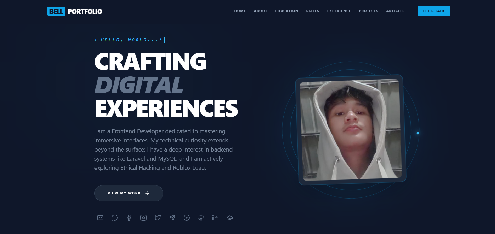
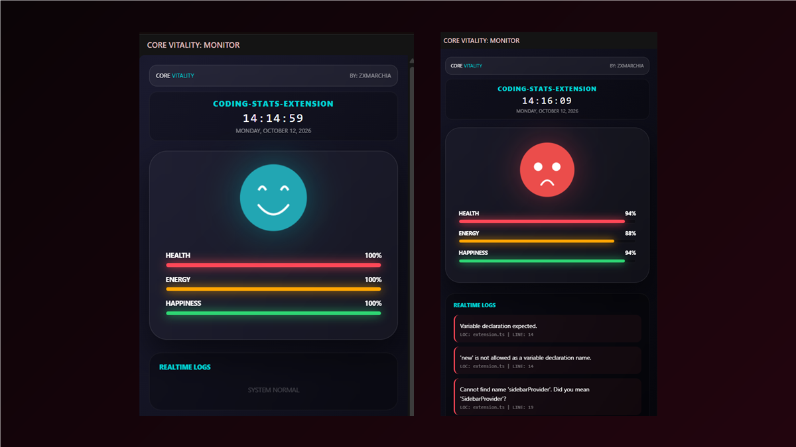
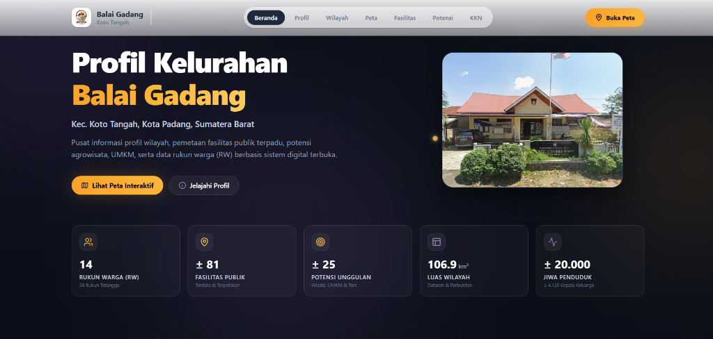
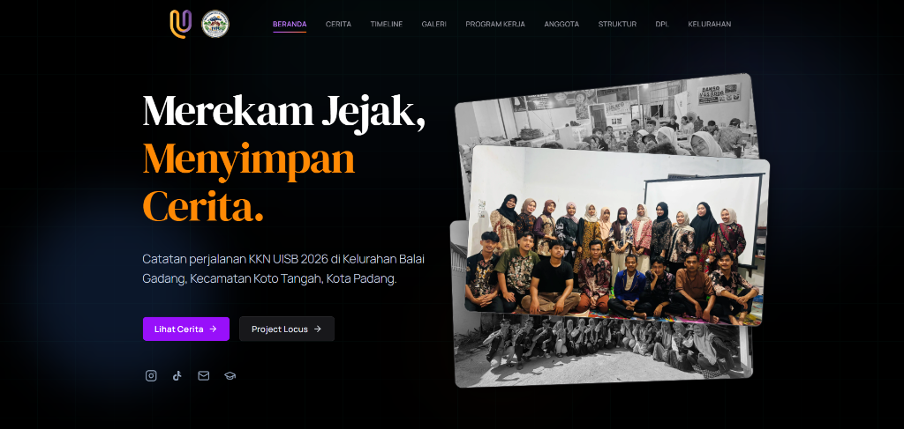

<div align="center">

<!-- ======================================================== -->
<!-- 🌌 HEADER ANIMASI DINAMIS (100% RESPONSIF) -->
<!-- ======================================================== -->


<br>

<!-- 🥀 KUTIPAN KODING & GALAU MENGETIK OTOMATIS -->
<a href="https://nottbell.vercel.app">
  
</a>

<br><br>

<!-- 🛡️ STATUS BADGE INTERAKTIF -->
<p align="center">
  <a href="https://nottbell.vercel.app">
    
  </a>
  <a href="https://github.com/notbell1">
    
  </a>
  <a href="#-zona-3--galeri-9-proyek--karya-unggulan">
    
  </a>
  <a href="#-zona-6--hubungi-saya--statistik-github">
    
  </a>
</p>

<!-- 🧭 MENU NAVIGASI CEPAT -->
<p align="center">
  <sub><b>🗺️ PILIHAN PENJELAJAHAN MENU:</b></sub><br>
  <a href="#-zona-1--status-diri--catatan-kelam"><code>[ 📍 STATUS & KISAH ]</code></a> &bull;
  <a href="#-zona-2--ruang-percakapan--jejak-rasa"><code>[ 📍 RUANG PERCAKAPAN ]</code></a> &bull;
  <a href="#-zona-3--galeri-9-proyek--karya-unggulan"><code>[ 📍 GALERI PROYEK ]</code></a> &bull;
  <a href="#-zona-4--keahlian--teknologi-koding"><code>[ 📍 KEAHLIAN & TEKNOLOGI ]</code></a> &bull;
  <a href="#-zona-5--playlist-koding-tengah-malam"><code>[ 📍 PLAYLIST MALAM ]</code></a> &bull;
  <a href="#-zona-6--hubungi-saya--statistik-github"><code>[ 📍 KONTAK & STATISTIK ]</code></a>
</p>

<p align="center">
  
</p>

</div>

<br>

---

# <div align="center"><b><font color="#fb7185">🥀 ZONA 1 : STATUS DIRI & CATATAN KELAM</font></b></div>

<div align="center">

> *"Di dunia open world yang luas ini, setiap baris kode adalah cara untuk bertahan hidup ketika orang yang paling kamu perjuangkan memilih menghilang dari radar."*

<br>

| Karakteristik | Kondisi & Parameter |
| :--- | :--- |
| **Nama Pengembang** | **Abbel (Notbell1)** |
| **Peran & Fokus** | Pengembang Full-Stack & Perancang Antarmuka Web |
| **Tingkat Pengalaman** | `LEVEL 99` *(Kompilasi Larut Malam & Arsitektur Kode)* |
| **Kondisi Hati (HP)** | `[░░░░░░░░░░░░░░░░░░░░] 00 / 100` &bull; **Patah Hati Akut** |
| **Kapasitas Rindu (MP)** | `[████████████████████] 999 / 999` &bull; **Meluap Tanpa Henti** |
| **Tingkat Kewarasan** | `[██████████░░░░░░░░░░] 42 / 100` &bull; **Bertahan dengan Kopi Hitam** |
| **Keahlian Pasif** | 🕯️ **Fokus Tengah Malam** *(+150% kecepatan koding setelah jam 2 pagi)* |
| **Beban Abadi** | 💔 **Memori Masa Lalu** *(Memory leak di ingatan yang tak bisa di-free)* |

</div>

<br>

```javascript
/**
 * Catatan Memori Inti Sistem — /dev/hati/pointer_rusak.js
 * Target: Blok memori yang pernah dialokasikan untuk seseorang
 */
const notbell = {
  identitas: "Abbel (Notbell1)",
  profesi: "Full-Stack Engineer & Cyber Security Artisan",
  kondisi: "Tenggelam dalam sunyi, bangkit dalam baris kode.",

  catatanTengahMalam: {
    asupanKopi: "Tak terhitung cangkir per malam",
    jamFavorit: "03:14 AM (saat dunia terlelap dan rindu mulai berbisik)",
    suaraLatar: "Rintik hujan di jendela & gemerisik piringan hitam Lo-Fi",
    statusHati: "SIGSEGV: Mencoba mengakses alamat memori RASA (Ternyata bernilai Null)"
  },

  prinsip: "Ketika manusia memilih pergi, kompilasi kode adalah satu-satunya yang setia dieksekusi tanpa ingkar janji."
};
```

<div align="center">

**“AKU MERANCANG SISTEM AGAR TIDAK PERNAH CRASH,  
SEPERTI HATIKU YANG TERLANJUR CRASH KARENA KEPERGIANMU.”**

</div>

<br>

---

# <div align="center"><b><font color="#fb7185">💬 ZONA 2 : RUANG PERCAKAPAN & JEJAK RASA</font></b></div>

<div align="center">
<sub>👇 Dekati pengembang dan pilih topik percakapan di bawah ini:</sub>
</div>

<br>

<details>
<summary><b>▶ [PERCAKAPAN 1] "Kenapa masih betah ngoding sampai larut malam begini?"</b></summary>
<br>

> **Abbel:**  
> *"Karena di jam 3 pagi, dunia berhenti menuntut banyak hal. Tidak ada notifikasi palsu, tidak ada harapan semu. Yang ada hanya layar monitor dengan tema gelap, secangkir kopi dingin, dan logika koding yang tidak pernah berbohong padaku."*
>
> 🎁 **Hadiah yang kamu temukan:**  
> `+1 Kopi Tubruk Hangat` &bull; `+50 Poin Ketenangan Jiwa`

</details>

<details>
<summary><b>▶ [PERCAKAPAN 2] "Bisa coba telusuri (debug) penyebab hatimu terluka?"</b></summary>
<br>

```bash
[GDB Debugger Sedang Berjalan]
(gdb) target remote /dev/hati/core_dump
(gdb) backtrace
#0  0x00007fff99a1 in jatuh_cinta_sendirian() at rasa.c:142
#1  0x00007fff99bf in berharap_lebih() at angan.c:88
#2  0x00007fff9a10 in diabaikan_tanpa_kabar() at realita.c:12
#3  0x00007fff9a55 in main() at hidup.c:999
[GDB Trace Selesai] Signal diterima: SIGHEARTBREAK (Koneksi diputus sepihak oleh lawan bicara)
```

</details>

<details>
<summary><b>▶ [PERCAKAPAN 3] "Apakah commit masa lalu itu masih bisa di-revert?"</b></summary>
<br>

> **Abbel:**  
> *"Di terminal git, kamu cukup mengetik `git revert HEAD~1` dan file akan kembali utuh seperti sediakala. Tapi di dunia nyata, kata-kata yang terlanjur terucap dan keputusan dia untuk pergi sudah masuk ke branch permanen yang terkunci write-protected."*

</details>

<details>
<summary><b>▶ [PERCAKAPAN 4] "Buka brankas pesan yang tak pernah sempat terkirim..."</b></summary>
<br>

```text
📁 /arsip/rahasia/draf_pesan_terpendam.txt
---------------------------------------------------------------------
"Terima kasih sudah pernah singgah walau hanya sekejap.
Portofolio ini kubangun bukan hanya untuk mencari panggung dunia,
tapi sebagai monumen sunyi bahwa aku pernah berjuang sekeras ini
untuk menjadi seseorang yang pantas kamu banggakan.
Semoga bahagiamu di sana selalu berjalan lancar tanpa error."
---------------------------------------------------------------------
Status: [DRAF TERSIMPAN • TIDAK AKAN PERNAH DIKIRIM]
```

</details>

<details>
<summary><b>▶ [KODE RAHASIA] "Gunakan kode cheat untuk bertahan hidup di dunia ini"</b></summary>
<br>

```sql
UPDATE jiwa 
SET rasa_sakit = 0, fokus_koding = 100, semangat_berkarya = 999 
WHERE nama_target = 'Abbel' AND kenangan_lama IS NOT NULL;

-- Output Sistem:
-- Baris berhasil diperbarui: 1 baris terpengaruh.
-- Peringatan: Log kenangan tidak dapat dihapus, hanya dialihkan menjadi karya nyata.
```

</details>

<br>

---

# <div align="center"><b><font color="#fb7185">🎨 ZONA 3 : GALERI 9 PROYEK & KARYA UNGGULAN</font></b></div>

<div align="center">
<sub>Berikut adalah 9 karya nyata yang lahir dari dedikasi dan malam-malam panjang koding. Lengkap dengan gambar pratinjau dan tautan langsung:</sub>
</div>

<br>

<!-- ========================================== -->
<!-- PROYEK 1: XEOO AUDITOR -->
<!-- ========================================== -->
### 1. 🛡️ Xeoo Auditor — Platform Audit & Keamanan Web
<p align="center">
  <a href="https://xeooauditor.vercel.app">
    
  </a>
</p>

Platform analisis mendalam untuk memeriksa celah keamanan situs web, kepatuhan header HTTP, skor performa, dan kerentanan SSL secara instan dengan laporan interaktif yang mudah dipahami.

- **Kategori:** Keamanan Siber, Alat Analisis & Kualitas Web
- **Teknologi Utama:** `React` &bull; `TypeScript` &bull; `Tailwind CSS` &bull; `Vite` &bull; `Web Security APIs`
- **Tautan Cepat:** [🌐 Buka Website / Demo](https://xeooauditor.vercel.app) &bull; [📦 Lihat Repositori GitHub](https://github.com/notbell1/xeooauditor)

<details>
<summary><b>🔍 Rincian Teknis & Kemampuan Xeoo Auditor</b></summary>
<br>

- Pemeriksaan otomatis header keamanan (`CSP`, `HSTS`, `X-Frame-Options`, `CORS`).
- Evaluasi performa web terintegrasi dan saran optimasi render.
- Antarmuka visual bertema gelap modern dengan animasi metrik real-time.

</details>

<br>

<!-- ========================================== -->
<!-- PROYEK 2: XEOO TOOLS -->
<!-- ========================================== -->
### 2. ⚡ Xeoo Tools — Kumpulan Alat Pengembang Multi-Fungsi
<p align="center">
  <a href="https://xeootools.vercel.app">
    
  </a>
</p>

Satu wadah untuk berbagai perkakas harian pengembang: mulai dari encoder/decoder Base64, pemformat JSON, kalkulator regex, generator hash, hingga converter warna instan tanpa iklan.

- **Kategori:** Utilitas Web & Perkakas Harian Pengembang
- **Teknologi Utama:** `React` &bull; `TypeScript` &bull; `Vite` &bull; `Tailwind CSS`
- **Tautan Cepat:** [🌐 Buka Website / Demo](https://xeootools.vercel.app) &bull; [📦 Lihat Repositori GitHub](https://github.com/notbell1/xeootools)

<details>
<summary><b>🔍 Rincian Teknis & Kemampuan Xeoo Tools</b></summary>
<br>

- Pemrosesan 100% di sisi klien (client-side) tanpa menyimpan data rahasia pengguna di server.
- Modul alat instan dengan kecepatan rendering tinggi dan keyboard shortcuts.

</details>

<br>

<!-- ========================================== -->
<!-- PROYEK 3: 3D SOLAR SYSTEM PORTFOLIO -->
<!-- ========================================== -->
### 3. 🪐 3D Solar System Portfolio — Portofolio Interaktif Tata Surya
<p align="center">
  <a href="https://nottbell.vercel.app">
    
  </a>
</p>

Portofolio pribadi berbasis simulasi tata surya 3D interaktif. Planet-planet beredar di orbitnya yang mewakili keahlian dan riwayat proyek dengan efek partikel kosmik yang memukau.

- **Kategori:** Eksperimen Web 3D & Portofolio Personal
- **Teknologi Utama:** `React` &bull; `TypeScript` &bull; `Tailwind CSS` &bull; `Vite` &bull; `Framer Motion`
- **Tautan Cepat:** [🌐 Buka Website / Demo](https://nottbell.vercel.app) &bull; [📦 Lihat Repositori GitHub](https://github.com/notbell1/portfolio)

<details>
<summary><b>🔍 Rincian Teknis & Kemampuan Portofolio Tata Surya</b></summary>
<br>

- Orbit planet responsif 6 lapisan dengan kalkulasi trigonometri dinamis.
- Pemutar musik bertema kosmik terintegrasi dengan transisi antar halaman halus.

</details>

<br>

<!-- ========================================== -->
<!-- PROYEK 4: XEOO THEME SUITE -->
<!-- ========================================== -->
### 4. 🎨 Xeoo Dark Theme Suite — Ekstensi Tema VS Code Gelap
<p align="center">
  <a href="https://marketplace.visualstudio.com">
    
  </a>
</p>

Koleksi tema gelap premium untuk Visual Studio Code yang dirancang khusus untuk kenyamanan mata saat sesi koding maraton tengah malam dengan kontras warna sintaks yang seimbang.

- **Kategori:** Ekstensi IDE & Desain Tema Editor
- **Teknologi Utama:** `VS Code API` &bull; `JSON Grammar` &bull; `Color Science`
- **Tautan Cepat:** [📦 Lihat Repositori GitHub](https://github.com/notbell1/zx-theme)

<details>
<summary><b>🔍 Rincian Teknis & Kemampuan Tema VS Code</b></summary>
<br>

- Palet warna obsidian, mawar gelap (rose), dan safir dengan standar kontras WCAG AAA.
- Dukungan penyorotan sintaks (syntax highlighting) untuk lebih dari 30 bahasa pemrograman.

</details>

<br>

<!-- ========================================== -->
<!-- PROYEK 5: CORE VITALITY -->
<!-- ========================================== -->
### 5. 🏥 Core Vitality — Sistem Informasi Manajemen Klinik & Pasien
<p align="center">
  <a href="https://github.com/notbell1/core-vitality">
    
  </a>
</p>

Aplikasi berbasis web untuk digitalisasi operasional klinik kesehatan: pendaftaran pasien, pencatatan rekam medis digital, manajemen antrean poliklinik, dan inventaris obat.

- **Kategori:** Sistem Informasi Manajemen & Kesehatan Digital
- **Teknologi Utama:** `PHP` &bull; `Laravel` &bull; `MySQL` &bull; `Bootstrap` &bull; `JavaScript`
- **Tautan Cepat:** [📦 Lihat Repositori GitHub](https://github.com/notbell1/core-vitality)

<details>
<summary><b>🔍 Rincian Teknis & Kemampuan Core Vitality</b></summary>
<br>

- Sistem hak akses multi-role (Admin, Dokter, Perawat, dan Farmasi).
- Pelaporan rekam medis terenkripsi dan pencetakan struk tagihan otomatis.

</details>

<br>

<!-- ========================================== -->
<!-- PROYEK 6: NTTBELL ASSISTANT -->
<!-- ========================================== -->
### 6. 🤖 Nttbell Assistant — Bot Otomasi Pintar & Asisten Virtual
<p align="center">
  <a href="https://github.com/notbell1/nttbell-assistant">
    
  </a>
</p>

Asisten virtual cerdas berbasis perintah yang dirancang untuk otomasi tugas harian, manajemen server Discord/Telegram, pengingat jadwal otomatis, dan pemantauan sistem.

- **Kategori:** Otomasi, Bot Cerdas & Asisten Virtual
- **Teknologi Utama:** `Python` &bull; `Node.js` &bull; `REST APIs` &bull; `Webhooks`
- **Tautan Cepat:** [📦 Lihat Repositori GitHub](https://github.com/notbell1/nttbell-assistant)

<details>
<summary><b>🔍 Rincian Teknis & Kemampuan Nttbell Assistant</b></summary>
<br>

- Integrasi webhook pesan instan dengan respons natural sub-detik.
- Otomasi pembersihan cache server dan pengiriman status kesehatan sistem berkala.

</details>

<br>

<!-- ========================================== -->
<!-- PROYEK 7: BALAI GADANG WEB GIS -->
<!-- ========================================== -->
### 7. 🗺️ Pemetaan Potensi Wilayah Balai Gadang 2026 — Web GIS Interaktif
<p align="center">
  <a href="https://balai-gadang.vercel.app">
    
  </a>
</p>

Sistem informasi geografis (Web GIS) interaktif untuk memetakan sebaran potensi UMKM, fasilitas umum, batas wilayah, dan demografi Kelurahan Balai Gadang secara presisi.

- **Kategori:** Sistem Informasi Geografis (GIS) & Portal Profil Desa
- **Teknologi Utama:** `React` &bull; `TypeScript` &bull; `Leaflet GIS` &bull; `Tailwind CSS` &bull; `Vite`
- **Tautan Cepat:** [🌐 Buka Website / Demo](https://balai-gadang.vercel.app) &bull; [📦 Lihat Repositori GitHub](https://github.com/notbell1/balai-gadang)

<details>
<summary><b>🔍 Rincian Teknis & Kemampuan Web GIS Balai Gadang</b></summary>
<br>

- Pemetaan layer poligon batas RW/RT dan penanda interaktif fasilitas umum.
- Pencarian data lokasi real-time dengan filter kategori terpadu dan mobile responsive.

</details>

<br>

<!-- ========================================== -->
<!-- PROYEK 8: KKN BALAI GADANG LOGBOOK -->
<!-- ========================================== -->
### 8. 📖 Logbook KKN Balai Gadang 2026 — Portal Catatan Digital KKN
<p align="center">
  <a href="https://kkn-uisb-balaigadang.vercel.app">
    
  </a>
</p>

Platform web modern untuk dokumentasi aktivitas harian, pelaporan program kerja pengabdian masyarakat, rekap presensi tim, dan galeri kegiatan mahasiswa KKN secara transparan.

- **Kategori:** Portal Dokumentasi Digital & Manajemen Program Kerja
- **Teknologi Utama:** `React` &bull; `TypeScript` &bull; `Tailwind CSS` &bull; `Vite`
- **Tautan Cepat:** [🌐 Buka Website / Demo](https://kkn-uisb-balaigadang.vercel.app) &bull; [📦 Lihat Repositori GitHub](https://github.com/notbell1/kkn-uisb-balaigadang)

<details>
<summary><b>🔍 Rincian Teknis & Kemampuan Logbook KKN</b></summary>
<br>

- Timeline interaktif kegiatan harian lengkap dengan galeri foto beresolusi optimal.
- Struktur data modular yang memudahkan verifikasi pencapaian target program kerja.

</details>

<br>

<!-- ========================================== -->
<!-- PROYEK 9: PUSKESWAN APPS -->
<!-- ========================================== -->
### 9. 🐾 Puskeswan Apps — Sistem Rekam Medis & Layanan Hewan
<p align="center">
  <a href="https://github.com/notbell1/puskeswan">
    
  </a>
</p>

Aplikasi pelayanan kesehatan hewan terpadu untuk Pusat Kesehatan Hewan (Puskeswan): rekam medis pasien hewan peliharaan & ternak, jadwal vaksinasi, serta inventaris obat-obatan.

- **Kategori:** Manajemen Rekam Medis Hewan & Layanan Publik
- **Teknologi Utama:** `PHP` &bull; `Laravel` &bull; `MySQL` &bull; `Bootstrap` &bull; `JavaScript`
- **Tautan Cepat:** [📦 Lihat Repositori GitHub](https://github.com/notbell1/puskeswan)

<details>
<summary><b>🔍 Rincian Teknis & Kemampuan Puskeswan Apps</b></summary>
<br>

- Modul pendaftaran jenis hewan, pencatatan diagnosa dokter hewan, dan resep obat.
- Dashboard statistik kunjungan dan riwayat vaksinasi dengan hak akses bertingkat.

</details>

<br>

---

# <div align="center"><b><font color="#fb7185">🛠️ ZONA 4 : KEAHLIAN & TEKNOLOGI KODING</font></b></div>

<div align="center">
<sub>Berikut adalah tumpukan teknologi dan alat yang saya gunakan untuk membangun sistem handal:</sub>
</div>

<br>

#### 🌐 1. Bahasa Pemrograman & Pondasi Web
<p align="center">
  
</p>

#### ⚡ 2. Kerangka Kerja & Pustaka Antarmuka
<p align="center">
  
</p>

#### 🗄️ 3. Basis Data & Layanan Backend
<p align="center">
  
</p>

#### 🚀 4. Deployment, Cloud & Manajemen Versi
<p align="center">
  
</p>

#### 🎨 5. Lingkungan Kerja & Desain
<p align="center">
  
</p>

<br>

---

# <div align="center"><b><font color="#fb7185">🎧 ZONA 5 : PLAYLIST KODING TENGAH MALAM</font></b></div>

<div align="center">

> *"Koding tanpa musik seperti cinta tanpa balasan: hampa, sunyi, dan rawan menimbulkan kekosongan pikiran."*

<br>

| Judul Lagu & Musisi | Suasana Hati | Durasi | Tautan Pemutar |
| :--- | :--- | :---: | :---: |
| 🌧️ **Glimpse of Us** &bull; Joji | Kehampaan Rindu Mendalam | `3:53` | [▶ Putar Musik](https://www.youtube.com/results?search_query=joji+glimpse+of+us) |
| 🥀 **Die With A Smile** &bull; Lady Gaga, Bruno Mars | Mengikhlaskan dengan Senyuman | `4:11` | [▶ Putar Musik](https://www.youtube.com/results?search_query=die+with+a+smile) |
| 🌌 **Ghost** &bull; Justin Bieber | Bayangan yang Tak Pernah Hilang | `2:33` | [▶ Putar Musik](https://www.youtube.com/results?search_query=justin+bieber+ghost) |
| ☕ **Midnight Lo-Fi Coding Beats** &bull; Berbagai Musisi | Fokus Penuh di Larut Malam | `∞ jam` | [▶ Putar Musik](https://www.youtube.com/results?search_query=lofi+hip+hop+radio) |

</div>

<br>

---

# <div align="center"><b><font color="#fb7185">📡 ZONA 6 : HUBUNGI SAYA & STATISTIK GITHUB</font></b></div>

<div align="center">

<sub>Ingin berkolaborasi, mendiskusikan peluang proyek baru, atau sekadar berbagi cerita koding? Jangan ragu untuk terhubung!</sub>

<br>

<!-- KARTU STATISTIK GITHUB (100% RESPONSIF) -->
<table align="center" border="0" cellpadding="0" cellspacing="8">
  <tr>
    <td align="center">
      
    </td>
  </tr>
  <tr>
    <td align="center">
      
    </td>
  </tr>
  <tr>
    <td align="center">
      
    </td>
  </tr>
</table>

<br>

<!-- TAUTAN SOSIAL MEDIA & KONTAK -->
<p align="center">
  <a href="https://linkedin.com/in/abbel">
    
  </a>
  <a href="https://instagram.com/nottbell">
    
  </a>
  <a href="https://tiktok.com/@notbe11">
    
  </a>
  <a href="mailto:abbel@example.com">
    
  </a>
</p>

<br>

<!-- ======================================================== -->
<!-- 🌌 FOOTER PENUTUP CAPSULE -->
<!-- ======================================================== -->


<p align="center">
  <sub>Dibuat dengan ❤️ dan setetes kesedihan oleh <b>Abbel (Notbell1)</b> &bull; Terbuka untuk kolaborasi proyek</sub>
</p>

</div>
