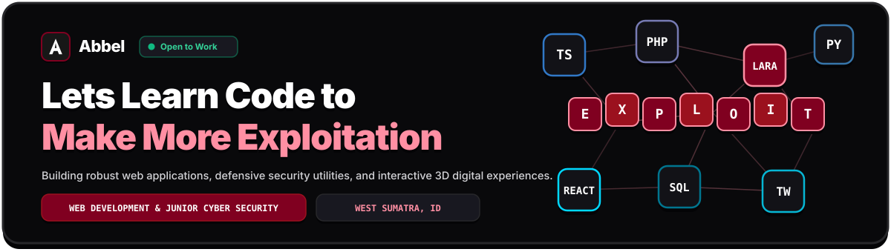
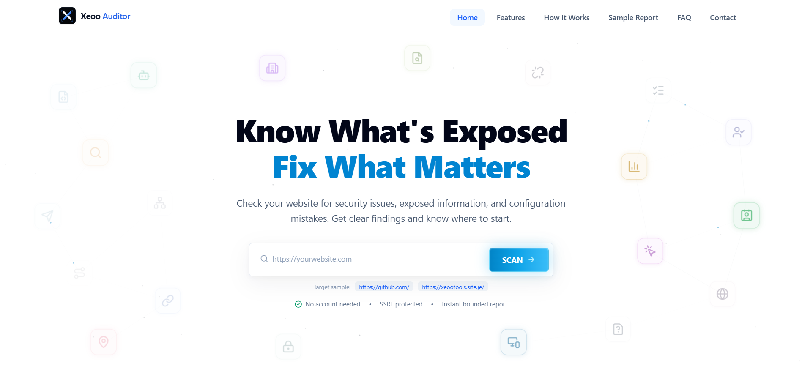
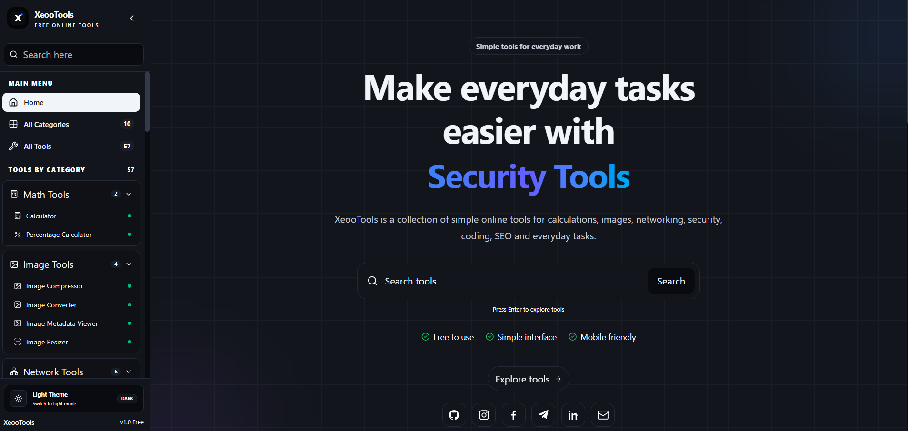
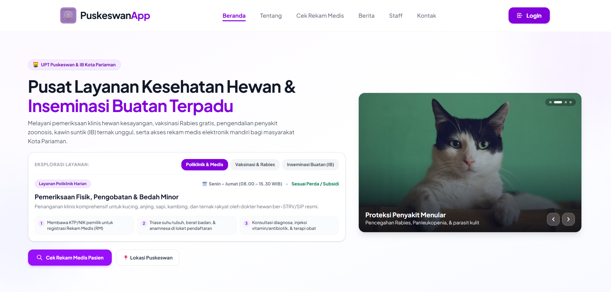
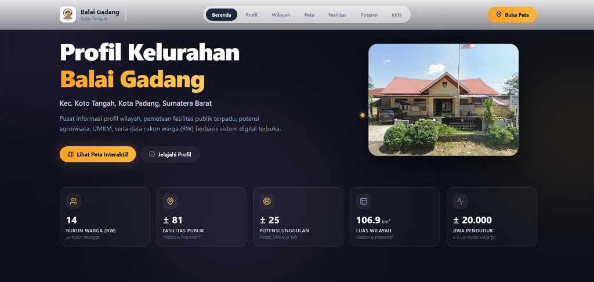
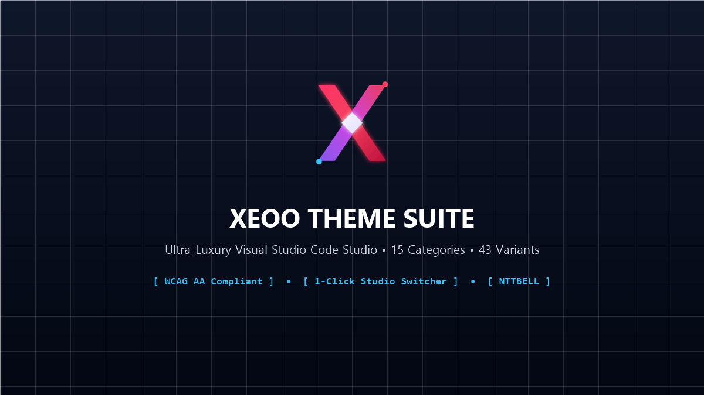
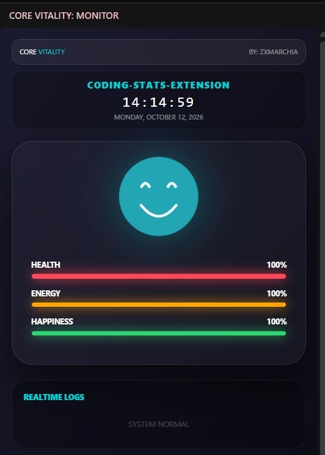
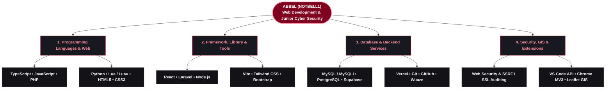
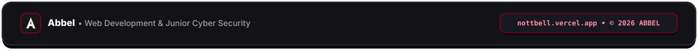

  

  
  
  
  

---

## Personal & Professional Overview

I engineer web applications that are responsive, accessible, and fast. My focus spans **Web Development** and **Junior Cyber Security** — building resilient backend APIs with PHP/Laravel and relational databases, modern frontend interfaces with React/TypeScript/Tailwind CSS, developer extensions, and defensive security utilities incorporating SSRF boundary firewalls, CSRF validation, and input sanitization.

| Attribute | Details |
| :--- | :--- |
| **Name / Handle** | **Abbel** (`Nottbell` / `notbell1`) |
| **Specialty** | **Web Development & Junior Cyber Security** |
| **Education** | B.S. in Information Systems — [Universitas Islam Sumatera Barat](https://uisb.ac.id/) |
| **Location** | West Sumatra, Indonesia |
| **Portfolio** | [nottbell.vercel.app](https://nottbell.vercel.app) |

---

## Featured Projects

### 1. Security & Developer Utilities

| Project | Category | Overview & Key Deliverables | Tech Stack | Links |
| :--- | :--- | :--- | :---: | :---: |
| **Xeoo Auditor** | Cyber Security & Audit | Automated web security diagnostics platform with a server-side SSRF boundary firewall, 5-pillar audit engine (SSL/TLS, HSTS/CSP headers, latency, SEO, privacy), and zero-PII ephemeral retention. | `React 19` `TypeScript` `Tailwind v4` `PHP 8.x` `MySQL` | [Live Site](https://xeooauditor.xo.je/) [View Repository](https://github.com/notbell1/xeoo-auditor) |
| **Xeoo Tools** | Developer Tools & CTF | Multi-suite web utility ecosystem with 30+ developer tools, client-side media optimization lab, and an isolated Defacement CTF cyber platform with server-authoritative flag verification. | `React` `TypeScript` `Tailwind CSS` `Vite` `PHP` • `MySQL` | [Live Site](https://xeootools.site.je/) [View Repository](https://github.com/notbell1/xeoo-tools) |
| **Nttbell Assistant** | Browser Extension | Visual privacy and anti-shoulder surfing shield for WhatsApp Web built on Chrome Manifest V3. Masks sensitive chats, contact identities, and media with hover-to-reveal capability. | `TypeScript` `Vite` `Chrome MV3` `DOM Shield` | [View Repository](https://github.com/notbell1/nttbell-assistant) |

  
  

---

### 2. Fullstack Web & Geospatial Systems

| Project | Category | Overview & Key Deliverables | Tech Stack | Links |
| :--- | :--- | :--- | :---: | :---: |
| **PuskeswanApp** | Fullstack Web App | Integrated Veterinary Medical Record & Rabies Surveillance System (GHPR) for UPTD Puskeswan Pariaman City. Features real-time clinical queue triage, anti-bot NIK self-service portal, -96% query reduction, and 60/60 automated Pest PHP tests. | `Laravel` `React 19` `Inertia.js` `Tailwind v4` `MySQL` • `Pest` | [View Repository](https://github.com/notbell1/puskeswanapp) |
| **Mapping of Regional Potential in Balai Gadang 2026** | Web GIS & Regional Mapping | Interactive Web GIS for Balai Gadang Village, Padang City. Integrates spatial mapping of 81+ public facilities, 25+ regional economic & agrotourism potentials, RW boundaries, and demographic statistics. | `React 19` `Leaflet JS` `Tailwind v4` `GeoJSON` `Vite` | [Live Site](https://balai-gadang.vercel.app/) [View Repository](https://github.com/notbell1/balai-gadang) |
| **Balai Gadang KKN Logbook 2026** | Community Service & Web App | Digital field activity logbook and community documentation portal for the 2026 UISB University KKN program in Balai Gadang Village, featuring timeline tracking, photo storytelling, and member rosters. | `React 19` `Tailwind CSS` `Vite` `Framer Motion` | [Live Site](https://kkn-uisb-balaigadang.vercel.app/) [View Repository](https://github.com/notbell1/kkn-uisb-balaigadang) |

  
  

---

### 3. VS Code Extensions & Interactive 3D Web

| Project | Category | Overview & Key Deliverables | Tech Stack | Links |
| :--- | :--- | :--- | :---: | :---: |
| **Xeoo Theme Suite** | VS Code Extension | Ergonomically calibrated Visual Studio Code theme suite featuring 15 primary color categories and 43 variants (Dark, Soft, Light) with WCAG AA compliance and 1-Click Studio Switcher. | `TypeScript` `VS Code API` `Node.js` `WCAG AA` | [View Repository](https://github.com/notbell1/zx-theme) |
| **Core Vitality** | Developer Experience | Realtime developer health tracker and error diagnostics dashboard embedded in VS Code with an evolving interactive SVG companion and runtime error incident locator. | `TypeScript` `VS Code API` `Webview API` `SVG` | [View Repository](https://github.com/notbell1/core-vitality) |
| **3D Blocky Developer Portfolio** | Interactive 3D Web | Interactive 3D Blocky portfolio featuring a 247-piston dynamic word matrix, 20 zero-gravity floating 3D tech stack cubes with mid-air collision bursts, and constellation network lines. | `JavaScript` `Three.js` `Tailwind v4` `Vite` | [Live Site](https://nottbell.vercel.app) [View Repository](https://github.com/notbell1/portfolio) |

  
  

---

## Work History & Experience

| Role | Organization | Period | Highlights |
| :--- | :--- | :---: | :--- |
| **Fullstack Developer Intern** | Diskominfo Kota Pariaman | `Feb — Mar 2026` | Engineered [PuskeswanApp](https://github.com/notbell1/puskeswanapp) for UPT Puskeswan & IB Pariaman, digitizing manual veterinary records into centralized relational models and building responsive clinical workflows. |
| **Executive Leader** | PSAABR Budi Utama | `June 2025` | Delivered youth empowerment workshops focused on digital privacy awareness, cyber security fundamentals, and self-taught web development foundations. |
| **Chairman & Unit Coordinator** | ICT Volunteers (RTIK) — UISB Chapter | `Jul — Aug 2024` | Led student technical teams and coordinated regional digital literacy initiatives and coding workshops across universities in West Sumatra. |
| **Tax & Financial Staff** | Lilisen Tax Consultant | `2020 — 2022` | Handled corporate monthly accounting compliance, value added taxes (PPN), corporate withholding taxes (PPh 21, 23, 25), and audit reconciliations. |

---

## Technical Skills & Technology Stack

  

---

## Connect & Direct Channels

  
  
  
  
  

 

