<div align="center">

<!-- ======================================================== -->
<!-- 🌌 RETRO ARCADE / CYBER-DECK 2026 HEADER -->
<!-- ======================================================== -->


<br>

<!-- 🎮 ANIMATED CYBERPUNK CONSOLE SCREEN -->
<a href="https://nottbell.vercel.app">
  
</a>

<br><br>

<!-- 🕹️ CONTROLLER HUD & STATUS METRICS -->
<p align="center">
  <a href="https://nottbell.vercel.app">
    
  </a>
  <a href="https://github.com/notbell1">
    
  </a>
  <a href="#-stage-3--cartridge-select-room-13-karya-unggulan">
    
  </a>
  <a href="#-stage-6--multiplayer-lobby--player-stats">
    
  </a>
</p>

<!-- 🎮 RETRO D-PAD NAVIGATION -->
<p align="center">
  <code>╔═══════════════════════════════════════════════════════════════════════════════════╗</code><br>
  <code>║  🕹️ [D-PAD]: SELECT STAGE  ║  🅰️ [A]: EXECUTE QUEST  ║  🅱️ [B]: BACK TO TITLE   ║</code><br>
  <code>╚═══════════════════════════════════════════════════════════════════════════════════╝</code><br>
  <a href="#-stage-1--player-hud--character-attributes"><code>[ 📊 STAGE 1: PLAYER HUD ]</code></a> &bull;
  <a href="#-stage-2--playable-mini-game--interactive-rpg-terminal"><code>[ ⚔️ STAGE 2: BOSS FIGHT ]</code></a> &bull;
  <a href="#-stage-3--cartridge-select-room-13-karya-unggulan"><code>[ 💾 STAGE 3: 13 CARTRIDGES ]</code></a> &bull;
  <a href="#-stage-4--rpg-skill-tree--combat-arsenal"><code>[ ⚡ STAGE 4: SKILL TREE ]</code></a> &bull;
  <a href="#-stage-5--sound-test-room--retro-lo-fi-fm"><code>[ 📻 STAGE 5: SOUND TEST ]</code></a> &bull;
  <a href="#-stage-6--multiplayer-lobby--player-stats"><code>[ 📡 STAGE 6: MULTIPLAYER ]</code></a>
</p>

<p align="center">
  
</p>

</div>

---

## 📊 STAGE 1 : PLAYER HUD & CHARACTER ATTRIBUTES

<div align="center">

> *"Di dalam game open-world kehidupan, ketika cinta memilih disconnect tanpa sinyal, kompilasi baris kode adalah satu-satunya checkpoint yang tidak pernah mengkhianatimu."*

<br>

| Attribute Bar | Gauge Metric | In-Game Status Effect |
| :--- | :--- | :--- |
| **Player Handle** | `Abbel (Notbell1)` | Full-Stack Architect & Cyber Security Artisan |
| **Character Level** | `LEVEL 99` | **Max Tier Achieved** *(Midnight Compilation Mastery)* |
| **HP (Heart Points)** | `[░░░░░░░░░░] 0 / 100` | 💔 **Critical Heartbreak** *(Uncaught Exception: NullPointer)* |
| **MP (Midnight Power)** | `[██████████] 999 / 999` | ☕ **Overclocked** *(Infinite Caffeine Absorption Active)* |
| **Coding Velocity** | `[██████████] 150 WPM` | ⚡ **Hyper-Threaded** *(+200% Productivity between 01:00 - 04:00 AM)* |
| **Security Armor** | `[████████░░] 85 / 100` | 🛡️ **Two-Tier Rate Limiting Shield** *(Immune to Brute Force)* |
| **Sanity Gauge** | `[████░░░░░░] 42 / 100` | 🌧️ **Lo-Fi Melancholy Resonance** *(Refuses to touch legacy bugs)* |

</div>

```javascript
/* ══════════════════════════════════════════════════════════════════
 * CARTRIDGE MEMORY BUFFER: /dev/heart/save_state_slot0.bin
 * ══════════════════════════════════════════════════════════════════ */
const PlayerOne = {
  codename: "Abbel (Notbell1)",
  title: "Senior Full-Stack Engineer & Creative Interface Artisan",
  currentMission: "Building indestructible digital ecosystems while debugging memories.",

  battleGear: {
    caffeineSupply: "Midnight Robusta Espresso (No Sugar)",
    primeOperatingHour: "03:14 AM (Golden Hour of Architecture)",
    audioCompanion: "Retro Lo-Fi Beats & Rainy Window Ambiance",
    kernelSignal: "SIGHEARTBREAK: Connection closed by peer."
  },

  motto: "When human empathy crashes, deterministic code executes flawlessly."
};
```

---

## ⚔️ STAGE 2 : PLAYABLE MINI-GAME & INTERACTIVE RPG TERMINAL

<div align="center">
<sub>🎮 <b>PILIH AKSI DAN TEKAN TOMBOL UNTUK MEMAINKAN PETUALANGAN INTERAKTIF INI:</b></sub>
</div>

<br>

<details open>
<summary><b>🕹️ [PLAYABLE 1] "BOSS BATTLE: The 03:00 AM Critical Production Outage"</b></summary>
<br>

```text
╔══════════════════════════════════════════════════════════════════════════════╗
║  🚨 ALERT: Production Outage Detected!                                       ║
║  Boss: "The Giant Red N+1 Query & Memory Leak Monster" (HP: 9,999/9,999)    ║
║  Status: 160 looping SQL statements choking CPU core at 99.8% load!          ║
╚══════════════════════════════════════════════════════════════════════════════╝
```

**PILIH LANGKAH STRATEGIS ANDA:**

* [⚔️ **SERANGAN 1: Cast "Composite Indexing & GROUP BY Aggregation"**](https://github.com/notbell1/puskeswanapp#-optimasi-kinerja-basis-data-laravel-debugbar)
  > *Hasil:* **CRITICAL HIT!** Beban query berkurang **-96%** (dari 160 kueri ke 5 kueri). Boss Monster kehilangan 8,500 HP seketika!
* [🛡️ **SERANGAN 2: Deploy "Two-Tier Rate Limiting & CheckBlockedIp Shield"**](https://github.com/notbell1/puskeswanapp#-fitur-fitur-utama)
  > *Hasil:* **DEFENSE MATRIX ACTIVE!** Seluruh 300+ request brute-force otomatis terpental ke halaman error 429. Server aman terkendali!
* [☕ **ITEM PENDUKUNG: Minum Ramuan "Midnight Arabica Coffee"**](#-stage-5--sound-test-room--retro-lo-fi-fm)
  > *Hasil:* +200 Mana Points! Seluruh 60 Pest Feature Tests selesai diverifikasi dalam 4.2 detik! **BOSS DEFEATED! 🏆 VICTORY!**

</details>

<details>
<summary><b>💬 [PLAYABLE 2] "DIALOGUE TREE: Percakapan Larut Malam dengan Abbel"</b></summary>
<br>

> **Pengunjung:** *"Kenapa kamu begitu terobsesi merancang antarmuka se-detail dan se-interaktif ini?"*  
> 
> **Abbel:**  
> *"Bagi sebagian orang, web hanyalah kumpulan tag HTML dan stylesheet. Tapi bagiku, setiap transisi tombol, setiap palet kontras WCAG, dan setiap grafik interaktif adalah kanvas seni di mana kerapian logika berpadu dengan estetika. Di dunia di mana banyak janji berakhir semu, baris kode yang dieksekusi dengan presisi adalah karya yang bisa kupercayai sepenuhnya."*  
> 
> 🎁 **Item Dropped:** `[+1 Legendary Obsidian Crystal]` &bull; `[+100 EXP Repositori]`

</details>

<details>
<summary><b>🔓 [PLAYABLE 3] "KONAMI CHEAT CODE TERMINAL: Masukkan Kode Rahasia"</b></summary>
<br>

```text
INPUT SEQUENCE: [ ↑ ] [ ↑ ] [ ↓ ] [ ↓ ] [ ← ] [ → ] [ ← ] [ → ] [ 🅱️ ] [ 🅰️ ] [ START ]
```

```sql
-- CHEAT CODE DITERIMA! MENGAKTIFKAN MODE GOD-ARCHITECT:
UPDATE developer_state
SET 
    bugs_detected = 0,
    tests_passing_rate = '100% (60/60 PASSED)',
    design_fidelity = 'PIXEL_PERFECT',
    passion_to_build = 999999
WHERE developer_name = 'Abbel';

-- Status: 1 baris diperbarui. Semua repositori publik kini dalam performa puncak!
```

</details>

<details>
<summary><b>📁 [PLAYABLE 4] "INVENTORY VAULT: Brankas Pesan yang Terkunci"</b></summary>
<br>

```text
[ENCRYPTED VAULT // STORAGE SLOT: /secret/unsent_echoes.enc]
--------------------------------------------------------------------------------
"Terima kasih sudah pernah hadir walau sejenak.
 Seluruh 13 repositori ini tidak dibangun sekadar untuk unjuk kebolehan,
 melainkan sebagai saksi bisu bahwa aku pernah belajar, berjuang, dan bermimpi
 tanpa henti untuk menjadi arsitek sistem yang karyanya dapat dibanggakan.
 Semoga petualanganmu di luar sana selalu menemukan checkpoint terbaik."
--------------------------------------------------------------------------------
[STATUS: READ-ONLY DEPOSIT • PERMANENT ARCHIVE]
```

</details>

---

## 💾 STAGE 3 : CARTRIDGE SELECT ROOM (13 KARYA UNGGULAN)

<div align="center">
<sub>🎮 <b>SEMUA 13 REPOSITORI PUBLIK TELAH DILENGKAPI GIT TAG RESMI DAN TAMPILAN INTERAKTIF:</b></sub>
</div>

<br>

### 👑 REALM 1: ENTERPRISE & PUBLIC HEALTH QUESTS (EPIC TIER)

| Cartridge / Project | Description & Core Gameplay | Tech Engine | Quest Status |
| :--- | :--- | :---: | :---: |
| 🐾 **[PuskeswanApp v2.0.0](https://github.com/notbell1/puskeswanapp)**<br><sub>[Release v2.0.0](https://github.com/notbell1/puskeswanapp/releases/tag/v2.0.0)</sub> | **Sistem Rekam Medis Veteriner & Surveilans Rabies Terpadu**<br>Digitalisasi poliklinik hewan, triage antrean dokter realtime, surveilans kasus gigitan rabies (GHPR), portal cek RM mandiri NIK, serta optimasi kueri -96% (Debugbar). | `Laravel 13`<br>`React 19`<br>`Inertia v3`<br>`Tailwind v4`<br>`Pest PHP` | <br>⭐⭐⭐⭐⭐ |
| 🏛️ **[Balai Gadang Web GIS](https://github.com/notbell1/balai-gadang)**<br><sub>[Live Demo](https://balai-gadang.vercel.app/) &bull; [Release v1.0.0](https://github.com/notbell1/balai-gadang/releases/tag/v1.0.0)</sub> | **Web GIS Pemetaan Potensi Wilayah Balai Gadang 2026**<br>Pemetaan geospasial interaktif 80+ fasilitas umum, 25+ potensi UMKM & agrowisata, batas administratif RW, dan demografi wilayah secara presisi. | `React 19`<br>`TypeScript`<br>`Leaflet JS`<br>`Tailwind v4`<br>`GeoJSON` | <br>⭐⭐⭐⭐☆ |
| 🎓 **[KKN UISB Balai Gadang](https://github.com/notbell1/kkn-uisb-balaigadang)**<br><sub>[Live Demo](https://kkn-uisb-balaigadang.vercel.app/) &bull; [Release v1.0.0](https://github.com/notbell1/kkn-uisb-balaigadang/releases/tag/v1.0.0)</sub> | **Portal Resmi Dokumentasi Pengabdian KKN Mahasiswa 2026**<br>Dokumentasi program kerja multidisiplin, linimasa aktivitas harian tim pengabdian masyarakat, profil 21 mahasiswa lintas 5 prodi, dan galeri kegiatan. | `React`<br>`TypeScript`<br>`Tailwind CSS`<br>`Vite`<br>`Vercel` | <br>⭐⭐⭐⭐☆ |
| 💬 **[Feedback Proker KKN](https://github.com/notbell1/feedback-proker)**<br><sub>[Release v1.0.0](https://github.com/notbell1/feedback-proker/releases/tag/v1.0.0)</sub> | **Platform Feedback Komunitas & Umpan Balik Anonim**<br>Portal formulir publik penampung kesan, pesan, kritik, dan saran masyarakat terhadap program kerja tanpa perlu registrasi akun dengan moderasi admin aman. | `React 19`<br>`TypeScript`<br>`Tailwind CSS`<br>`Supabase`<br>`Vite` | <br>⭐⭐⭐☆☆ |

<br>

<p align="center">
  <a href="https://github.com/notbell1/puskeswanapp"></a>
  <a href="https://balai-gadang.vercel.app/"></a>
</p>

---

### 🛡️ REALM 2: CYBER SECURITY & TOOLING ARSENAL (TACTICAL TIER)

| Cartridge / Project | Description & Core Gameplay | Tech Engine | Quest Status |
| :--- | :--- | :---: | :---: |
| 🔍 **[Xeoo Auditor](https://github.com/notbell1/xeoo-auditor)** &bull; **[API](https://github.com/notbell1/xeoo-auditor-api)**<br><sub>[Live Site](https://xeooauditor.xo.je/) &bull; [Release v1.0.0](https://github.com/notbell1/xeoo-auditor/releases/tag/v1.0.0)</sub> | **Privacy-First Website Auditing Engine & Security Toolkit**<br>Inspeksi teknis menyeluruh sekali-klik: DNS records, sertifikat SSL/TLS, kepatuhan header keamanan HTTP (CSP, HSTS, X-Frame), dan teknologi server secara stateless. | `React 19`<br>`PHP 8.4`<br>`MySQL`<br>`Tailwind v4`<br>`Security APIs` | <br>⭐⭐⭐⭐⭐ |
| 🛠️ **[Xeoo Tools](https://github.com/notbell1/xeoo-tools)** &bull; **[API](https://github.com/notbell1/xeoo-tools-api)**<br><sub>[Live Site](https://xeootools.site.je/) &bull; [Release v1.0.0](https://github.com/notbell1/xeoo-tools/releases/tag/v1.0.0)</sub> | **Multi-Utility Online Developer Swiss Army Knife**<br>Koleksi perkakas harian pengembang: Base64 encoder/decoder, pemformat JSON, regex tester, hash generator (MD5/SHA), dan konversi warna instan tanpa server latency. | `React 18`<br>`TypeScript`<br>`Tailwind v4`<br>`PHP`<br>`MySQL` | <br>⭐⭐⭐⭐☆ |
| 🛡️ **[Nttbell Assistant](https://github.com/notbell1/nttbell-assistant)**<br><sub>[Release v1.0.0](https://github.com/notbell1/nttbell-assistant/releases/tag/v1.0.0)</sub> | **WhatsApp Web Visual Privacy Shield & Anti-Shoulder Surfing**<br>Ekstensi Chrome Manifest V3 cerdas yang mengaburkan pesan, kontak, dan media WhatsApp Web dengan efek hover-to-reveal & 100% pemrosesan lokal tanpa telemetri. | `Chrome MV3`<br>`TypeScript`<br>`Vite`<br>`MutationObserver`<br>`CSS Filter` | <br>⭐⭐⭐⭐☆ |

<br>

<p align="center">
  <a href="https://xeooauditor.xo.je/"></a>
  <a href="https://xeootools.site.je/"></a>
</p>

---

### 🎨 REALM 3: DEVELOPER ENVIRONMENT & VS CODE SUITES (FORGE TIER)

| Cartridge / Project | Description & Core Gameplay | Tech Engine | Quest Status |
| :--- | :--- | :---: | :---: |
| ⚡ **[Xeoo Error Lens](https://github.com/notbell1/xeoo-error-suite)**<br><sub>[Release v1.2.0](https://github.com/notbell1/xeoo-error-suite/releases/tag/v1.2.0)</sub> | **High-Contrast Inline Diagnostics & Restrained Pulse Animation**<br>Visualisasi error dan warning langsung di baris kode dengan animasi denyut halus, saran perbaikan deterministik lokal, dan kalibrasi kontras WCAG AA. | `VS Code API`<br>`TypeScript`<br>`Color Science`<br>`Zero Telemetry` | <br>⭐⭐⭐⭐☆ |
| 🎨 **[Xeoo Icon Theme](https://github.com/notbell1/xeoo-icon-suite)**<br><sub>[Release v0.1.0](https://github.com/notbell1/xeoo-icon-suite/releases/tag/v0.1.0)</sub> | **Cybernetic & Precision-Engineered VS Code File Icons**<br>72 ikon vektor kustom geometris yang dirancang tajam untuk keterbacaan explorer ukuran mikro 16×16 tanpa dependensi luar. | `SVG Vector`<br>`VS Code API`<br>`File Icon Spec` | <br>⭐⭐⭐☆☆ |
| ✨ **[Xeoo Theme Suite / ZX](https://github.com/notbell1/xeoo-theme-suite)**<br><sub>[Release v2.2.2](https://github.com/notbell1/xeoo-theme-suite/releases/tag/v2.2.2) &bull; [Repo zx-theme](https://github.com/notbell1/zx-theme)</sub> | **15 Master Color Categories & 43 Variants Theme Studio**<br>Suite tema editor lengkap (Dark, Soft, Light) dengan elevasi UI berjenjang (Header, Editor, Sidebar, Footer) dan 1-Click Studio Switcher di side panel. | `VS Code API`<br>`TextMate JSON`<br>`Color Harmony`<br>`WCAG AA` | <br>⭐⭐⭐⭐☆ |
| 📊 **[Core Vitality](https://github.com/notbell1/core-vitality)**<br><sub>[Release v1.0.0](https://github.com/notbell1/core-vitality/releases/tag/v1.0.0)</sub> | **Developer Velocity & Activity Analytics Dashboard for VS Code**<br>Pemantau waktu koding real-time, pengukur kecepatan baris kode, dan widget statistik sesi harian/mingguan langsung di status bar editor. | `VS Code API`<br>`TypeScript`<br>`Offline Analytics`<br>`Dashboard UI` | <br>⭐⭐⭐⭐☆ |

<br>

<p align="center">
  <a href="https://github.com/notbell1/xeoo-theme-suite"></a>
  <a href="https://github.com/notbell1/core-vitality"></a>
</p>

---

### 🌌 REALM 4: 3D WORLDS & STORYTELLING EXPEDITIONS (INDIE TIER)

| Cartridge / Project | Description & Core Gameplay | Tech Engine | Quest Status |
| :--- | :--- | :---: | :---: |
| 🪐 **[3D Solar System Portfolio](https://github.com/notbell1/portfolio)**<br><sub>[Live Site](https://nottbell.vercel.app/) &bull; [Release v1.0.0](https://github.com/notbell1/portfolio/releases/tag/v1.0.0)</sub> | **Interactive 3D Solar System Developer Portfolio Showcase**<br>Simulasi tata surya 3D kosmik interaktif di mana orbit planet-planet dinamis merepresentasikan portofolio, keahlian teknis, dan proyek unggulan. | `React 19`<br>`TypeScript`<br>`Three.js / Canvas`<br>`Tailwind CSS`<br>`Framer Motion` | <br>⭐⭐⭐⭐⭐ |
| 💖 **[Love Story Universe](https://github.com/notbell1/love-story)**<br><sub>[Release v1.0.0](https://github.com/notbell1/love-story/releases/tag/v1.0.0)</sub> | **Celestial Memory Lane & Interactive Digital Storytelling**<br>Eksperimen antarmuka naratif puitis bertema galaksi dan perjalanan kenangan digital dengan partikel dinamis dan tata letak mobile responsif. | `Creative Web`<br>`JavaScript`<br>`Audio API`<br>`CSS Particles` | <br>⭐⭐⭐☆☆ |

---

## ⚡ STAGE 4 : RPG SKILL TREE & COMBAT ARSENAL

```mermaid
flowchart TD
    Player(["🎮 PLAYER: ABBEL (NOTBELL1)<br/>Level 99 Midnight Architect"]):::player
    
    Player --> F_TREE["⚔️ FRONTEND SORCERY"]:::branch
    Player --> B_TREE["🛡️ BACKEND ENGINEERING"]:::branch
    Player --> S_TREE["🔒 SECURITY & SYSTEM OPS"]:::branch
    Player --> T_TREE["⚙️ TOOLING & EXTENSIONS"]:::branch

    F_TREE --> F1["React 19 & Next.js"]:::skill
    F_TREE --> F2["TypeScript & Modern JS"]:::skill
    F_TREE --> F3["Tailwind CSS v4 & LightningCSS"]:::skill
    F_TREE --> F4["Three.js, Canvas & Framer Motion"]:::skill

    B_TREE --> B1["Laravel 13 & PHP 8.4 (JIT)"]:::skill
    B_TREE --> B2["Inertia.js v3 (Server-Driven SPA)"]:::skill
    B_TREE --> B3["MySQL / PostgreSQL Optimization"]:::skill
    B_TREE --> B4["Supabase Real-Time DB"]:::skill

    S_TREE --> S1["Two-Tier Rate Limiting Architecture"]:::skill
    S_TREE --> S2["Web Vulnerability & SSL Inspection"]:::skill
    S_TREE --> S3["Zero-Trust File Binary Validation"]:::skill
    S_TREE --> S4["WCAG AA Ergonomic Accessibility"]:::skill

    T_TREE --> T1["VS Code Extension API Architecture"]:::skill
    T_TREE --> T2["Chrome Extension Manifest V3"]:::skill
    T_TREE --> T3["Pest PHP Automated Feature Testing"]:::skill
    T_TREE --> T4["Leaflet JS & GeoJSON Spatial Mapping"]:::skill

    classDef player fill:#00f3ff,stroke:#00a8b3,stroke-width:2px,color:#000,font-weight:bold;
    classDef branch fill:#22050e,stroke:#f43f5e,stroke-width:2px,color:#fff,font-weight:bold;
    classDef skill fill:#0b0407,stroke:#334155,stroke-width:1px,color:#e2e8f0;
```



<div align="center">

### 🛠️ Combat Equipment Grid

<p align="center">
  
</p>

</div>

---

## 📻 STAGE 5 : SOUND TEST ROOM (RETRO LO-FI FM)

<div align="center">

> *"Koding tanpa musik ibarat kompilasi tanpa output: hampa, hening, dan rawan memicu kebisingan pikiran."*

<br>

| Track # | Track Title & Artist | Sonic Vibe | Duration | Sound Test Link |
| :---: | :--- | :--- | :---: | :---: |
| `01` | 🌧️ **Glimpse of Us** &bull; Joji | Melancholic Midnight Echoes | `3:53` | [▶ PLAY TRACK](https://www.youtube.com/results?search_query=joji+glimpse+of+us) |
| `02` | 🥀 **Die With A Smile** &bull; Lady Gaga, Bruno Mars | Retro Soulful Resonance | `4:11` | [▶ PLAY TRACK](https://www.youtube.com/results?search_query=die+with+a+smile) |
| `03` | 🌌 **Ghost** &bull; Justin Bieber | Celestial Space Melancholy | `2:33` | [▶ PLAY TRACK](https://www.youtube.com/results?search_query=justin+bieber+ghost) |
| `04` | ☕ **Midnight Lo-Fi Coding Beats** &bull; Curated Chiptune | 100% Deep Focus Flow State | `∞ hrs` | [▶ PLAY TRACK](https://www.youtube.com/results?search_query=lofi+hip+hop+radio) |

</div>

---

## 📡 STAGE 6 : MULTIPLAYER LOBBY & PLAYER STATS

<div align="center">

<sub>Tertarik berkolaborasi dalam proyek open-source, membahas arsitektur web modern, atau merancang produk baru? Mari terhubung di lobby!</sub>

<br>

<!-- GITHUB STATS & STREAK CARDS -->
<p align="center">
  <br><br>
  <br><br>
  
</p>

<br>

<!-- MULTIPLAYER CONNECT LINKS -->
<p align="center">
  <a href="https://linkedin.com/in/abbel">
    
  </a>
  <a href="https://instagram.com/_ntbbll">
    
  </a>
  <a href="https://t.me/bellxss">
    
  </a>
  <a href="mailto:abbelkadafi@gmail.com">
    
  </a>
</p>

<br>

<!-- CAPSULE FOOTER -->


<p align="center">
  <code>[ GAME SAVED SUCCESSFULLY // TOTAL COMMITS PRESERVED // © 2026 ABBEL (NOTBELL1) ]</code>
</p>

</div>
